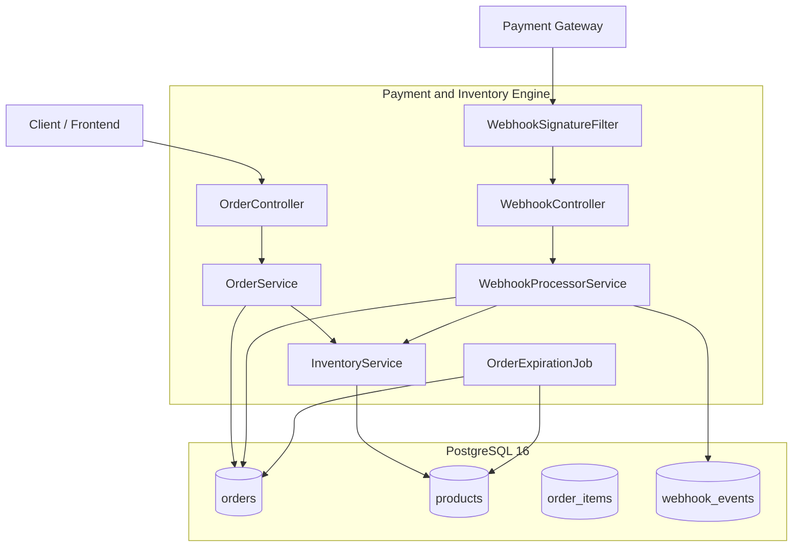

# Production-Grade Payment and Inventory Processing Engine


A high-performance RESTful engine built with **Java 21** and **Spring Boot 3.3**, designed for high-concurrency e-commerce and fintech operations.

The engine provides order lifecycle management, request idempotency, pessimistic inventory locking, cryptographic webhook verification (HMAC-SHA256), transactional payment processing, and automated order expiration.

---

## Architecture Overview

The system follows a layered architecture that separates REST controllers, business services, persistence, security, and domain entities.



---

## Core Technical Features

### 1. Request Idempotency

Prevents duplicate orders and repeated inventory deductions when clients retry requests.

- Requires an `Idempotency-Key` UUID header during order creation.
- Checks existing keys before creating new orders.
- Enforces a database-level `UNIQUE` constraint.
- Handles concurrent requests attempting to reuse the same key.

### 2. Pessimistic Inventory Concurrency Control

Protects inventory consistency when multiple customers attempt to purchase the same product simultaneously.

- Uses `PESSIMISTIC_WRITE` locking (`SELECT ... FOR UPDATE`).
- Prevents concurrent transactions from overselling inventory.
- Separates available stock from reserved stock.
- Uses transactional rollback when inventory is insufficient.

### 3. Cryptographic Webhook Security

Validates payment gateway notifications using HMAC-SHA256.

- Caches the raw HTTP request body for signature validation.
- Validates the `X-Webhook-Signature` header.
- Uses `MessageDigest.isEqual()` for constant-time comparison.
- Rejects missing or invalid signatures before business processing.

### 4. Transactional Webhook Processing

Ensures payment events are processed exactly once from the application's perspective.

- Stores external event identifiers in `webhook_events`.
- Detects duplicate webhook deliveries.
- Processes successful payments and commits reserved stock.
- Cancels failed payments and restores reserved inventory.

---

## Database Design

Database schema migrations are managed through Flyway.

| Table | Purpose | Important Constraints |
|---|---|---|
| `products` | Product catalog and inventory | Unique SKU, available and reserved stock |
| `orders` | Order lifecycle management | Unique idempotency key |
| `order_items` | Individual order line items | Foreign keys to orders and products |
| `webhook_events` | Payment event audit and deduplication | Unique event identifier, JSONB payload |

---

## Project Structure

```text
payment-inventory-engine/
│
├── .mvn/
│   └── wrapper/
│       └── maven-wrapper.properties
│
├── simulator/
│   ├── simulate_payment_gateway.py
│   └── simulate.sh
│
├── src/
│   ├── main/
│   │   ├── java/
│   │   │   └── com/ilich/paymentengine/
│   │   │       ├── config/
│   │   │       │   ├── DevDataLoader.java
│   │   │       │   ├── FilterConfig.java
│   │   │       │   ├── OpenApiConfig.java
│   │   │       │   └── SchedulingConfig.java
│   │   │       │
│   │   │       ├── controller/
│   │   │       │   ├── HomeController.java
│   │   │       │   ├── OrderController.java
│   │   │       │   ├── ProductController.java
│   │   │       │   └── WebhookController.java
│   │   │       │
│   │   │       ├── dto/
│   │   │       │   ├── request/
│   │   │       │   └── response/
│   │   │       │
│   │   │       ├── exception/
│   │   │       │
│   │   │       ├── model/
│   │   │       │   └── enums/
│   │   │       │
│   │   │       ├── repository/
│   │   │       │
│   │   │       ├── security/
│   │   │       │
│   │   │       └── service/
│   │   │
│   │   └── resources/
│   │       ├── db/
│   │       │   └── migration/
│   │       │       ├── V1__init_schema.sql
│   │       │       └── V2__seed_products.sql
│   │       │
│   │       ├── static/
│   │       │   └── index.html
│   │       │
│   │       ├── application.yml
│   │       └── application-local.yml
│   │
│   └── test/
│       └── java/
│           └── com/ilich/paymentengine/
│               ├── controller/
│               └── security/
│
├── .dockerignore
├── .gitignore
├── Dockerfile
├── docker-compose.yml
├── LICENSE
├── mvnw
├── pom.xml
└── README.md
```

---

## Quick Start — Docker Compose

### Requirements

- Docker
- Docker Compose

Start the application:

```bash
docker compose up --build
```

This starts:

1. PostgreSQL 16.
2. Flyway database migrations.
3. The Spring Boot application on port `8080`.

Stop the application:

```bash
docker compose down
```

To remove the database volume as well:

```bash
docker compose down -v
```

---

## Local Development

### Requirements

- Java 21 LTS
- Maven (optional, since the project includes Maven Wrapper)
- PostgreSQL 16, or the local H2 profile

Run with the default configuration:

```bash
./mvnw spring-boot:run
```

Run using the in-memory H2 profile:

```bash
./mvnw spring-boot:run -Dspring-boot.run.profiles=local
```

---

## API Documentation and Dashboard

Once the application is running:

| Resource | URL |
|---|---|
| Interactive Dashboard | http://localhost:8080/ |
| Swagger UI | http://localhost:8080/swagger-ui.html |
| OpenAPI JSON | http://localhost:8080/v3/api-docs |
| Health Check | http://localhost:8080/actuator/health |

---

## Payment Gateway and Concurrency Simulator

The project includes a simulator under `/simulator` to exercise the main payment and inventory workflows.

It validates:

1. Product catalog and seed data.
2. Idempotent order creation and retry replay.
3. Signed `payment.succeeded` webhook delivery.
4. Duplicate webhook event handling.
5. Invalid signature rejection.
6. A 20-thread concurrency race attempting to purchase the last available inventory unit.

Run the Python simulator:

```bash
python3 simulator/simulate_payment_gateway.py
```

Alternatively, run the Bash simulator:

```bash
./simulator/simulate.sh
```

---

## Automated Tests

Execute the test suite:

```bash
./mvnw clean test
```

The test suite covers:

- HMAC signature validation and tamper detection.
- Order idempotency and inventory validation.
- Webhook event deduplication.
- Successful and failed payment transitions.
- HTTP responses for valid, missing, and forged webhook signatures.

---

## Background Order Expiration

The scheduled `OrderExpirationJob` runs periodically and:

- Finds pending orders older than 15 minutes.
- Transitions eligible orders to `EXPIRED`.
- Releases their reserved inventory back to available stock.

---

## License

Distributed under the **Apache License 2.0**. See [LICENSE](LICENSE) for details.
